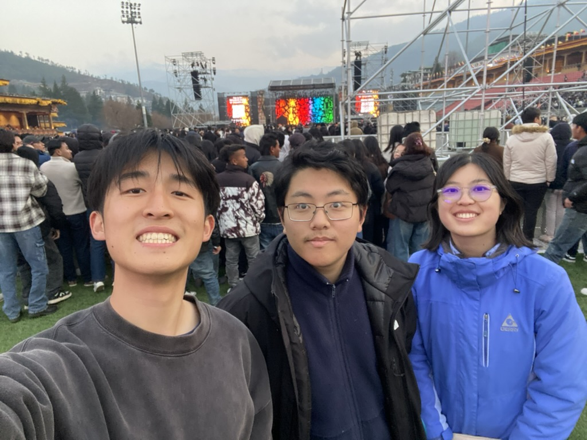

# January 24, 2025

I've been waiting for this day for a long time!

Sangay agrees to drive us to Thimphu for the Ed Sheeran concert, which is incredibly clutch because I love talking to Sangay. It feels like catching up with an old friend even when we had only met just this month. He's just such a genuine guy, and he lets me play my western songs in his car and we talk and sing until we reach Thimphu.

He drops us off at a parking lot near the venue and we walk over. There is already a line that has formed, and we wait in the line. There are not too many people in Bhutan but a significant fraction has pulled up for this concert. It's truly once in a lifetime here.

Still, it's a big stadium, and when we go in the sections are not too full, so even though our tickets are for the back section, we are able to move up one section. There isn't a great stage view but it's still solid.

We meet Gal and take some pictures. We all want to get concert merch, except it apparently hasn't arrived yet, and we wait for a long time and nobody really knows when it's going to come.

Later, we see the royal family enter the stadium from the top section. Everyone important in Bhutan is here for the concert. Ed says later on during the concert that he met the Royal Family and they took him around a bit.

In such a small country, you'll see the royal family from time to time, and actually in one of our earlier trips the kids saw a car transporting somebody in the royal family.

The concert is a little funny because it's clear that a lot of people here are for the vibes and because it's the first international concert, not because they know that much Ed Sheeran. They probably also haven't really been to concerts before, so in the sections where Ed asks people to sing along, the crowd is pretty quiet. Overall though the vibes are great and I'm amazed at what Ed is able to do. Because he doesn't have too much setup and a big band or anything, he can sort of just go with his team and his guitar, and he's the only person on stage, but he can fill up the stadium with such complex sounds. I really enjoy Tenerife Sea. 

