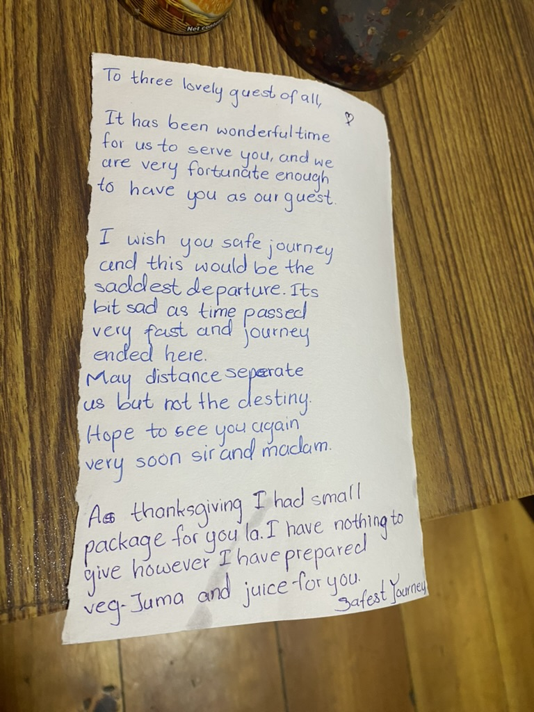

# January 27, 2025

It is our last academic day before the last test. We start with test review in the morning, and then run a session with miscellaneous problems. Both go quite well, and I think we’ve found fun and creative problems for the students to do that are not too hard.

In the last session, we do a bit where we pick a problem from each handout that we’ve done throughout camp, and we do those problems. This is like our last overall review, and. I think some of the students are a bit checked out mentally, and because of this camp probably was a good length, at least mathematically.

I’m really sad to see it end. I knew I loved teaching and math, but this program really deepened that and showed me how teaching can be such a powerful thing. I’m really invested in these students and I want them to do well!

When I go back to the hotel, one of the women working there has given us some handmade snacks and a note. She's the one who asked for pictures with both Zian and I. The snacks are a little spicy but delicious, and the note is remarkably well written for someone who doesn't speak much English. She took the time to write a full page message to us and it shows how poetic you can be with words even in a new language. I'm touched and I frankly don't even know what to say because we haven't really done much for her, but the people in the hotel have taken care of our food and housing for this whole month. There was one time where I told her that the food tasted really good and she started smiling and went back into the kitchen and told everyone there. Maybe they haven't had long term foreign guests that they've talked to before. But I'm very touched.

