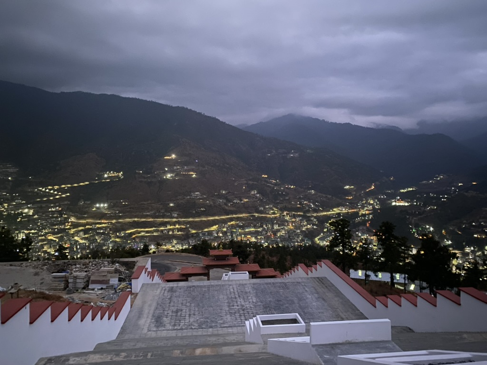

# January 29, 2025

The next morning, we stop by briefly for more pictures, but for less than an hour. We were considering picking up Roshan but the car is too full. Also we had some keys that we had to return.

We take some nice group photos and say goodbye again. Most of the kids came out just to hang, and when we leave some of them run after the car. Then we are off to go to Thimphu.

On the way to Thimphu I realize that truly I will likely not be able to see most of these kids ever again. I do want to go back to Bhutan but it’s hard to say when I will be able to.

I decide that I want to go to the IMO this summer. It’s in Australia, and if I could go as part of the Bhutanese team, that would be wonderful. This is something I’d really like to push for, and I’m not too sure how I will push for it (I hope it’s not decided too last minute) but I tell Tashi and Yeshey that I would really like to go as an observer. I will be in China in June and it sounds really nice to stop by Australia in July before going back to New York for apartment hunting.

In Thimphu we get to the hotel, and we have about an hour before a lunch with some ministry members. I take a walk and find a nice bridge. We don’t have too much time here, but I find that Thimphu is actually quite developed, and the parks are nice and there are some buildings here with lots of people. Lunch is at a really nice restaurant in a hotel, and we order indian food with something like 8 curries in small bowls. I get the fish option and I realize I’m eating much slower than the bhutanese people because they seem to just be eating all of the fish bones.

These are some pretty senior members in the ministry, especially the woman who seems to be one of Yeshey’s seniors. They give us really nice backpacks and shirts as gifts, and we tell them that the students were amazing and how this was a great trip. I really do want to stay involved with Bhutan’s education and IMO, and I think I’l try hard to make it happen.

After lunch we go to the post office, where Zian buys a bunch of stamps. I get one stamp and a postcard, which I think i’ll send home.

We then meet Gal in the city, and get more souveneirs. I get a bracelent and a bunch of refrigerator magnets. There’s a street with a bunch of shops with mostly the same things, and all of them are quite nice. I decide I do want a decent amount of merch, because really when else are you coming to Bhutan.

Afterwards we go up to the giant Buddha in Thimphu. It’s around sunset except there’s no sun since it’s all cloudy. You can go in under the Buddha, and we walk around even though it’s closed, because the monk inside is quite nice. At night, it’s lit up, and it’s the type of thing you can really see for miles and miles.

We go to a cafe afterwards in the city, and we talk to Gal’s friend Sonam. They are trying to start the first climbing gym in Bhutan. Sonam is super fit and he has dreads, and he talks about running a parkour gym for kids. He’s really outdoorsy and talks about the backpacking trips you can do at 4000 meters in Bhutan, which is pretty crazy. He has a wife in Taiwan that he sees from time to time, and as we walk in the city it’s plain that he knows everyone. Thimphu is maybe not so big after all, since it’s so easy to just run into friends. Even on the taxi back to our hotel, which Sonam takes with us, he sees a friend in the window of another car and talks to them briefly. 